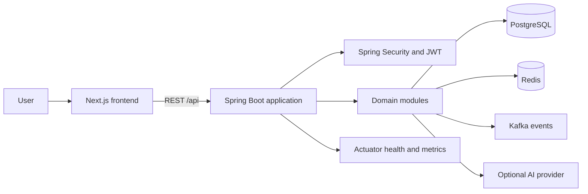

# SentinelX Project Workflow

## Scope

SentinelX is currently a TypeScript Next.js frontend backed by a Kotlin Spring Boot modular monolith. The implemented modules include authentication, payments, deterministic risk evaluation, threat lab, community, dry-run, operations, AI integration, and shared security/event infrastructure.

The repository describes a broader network-security intelligence product, but the inspected implementation is primarily a simulated fintech and engineering platform. Live packet capture, production network telemetry, and verified external threat-intelligence feeds are not established by the current codebase.

## System Flow

## Inputs and Outputs

Inputs currently supported by the visible application include registration and login data, payment requests, risk evaluation parameters, threat-lab scenario selections, community reports, dry-run definitions, and operational queries. Request validation is performed through Spring validation DTOs where configured.

Outputs include authenticated user responses, payment state and history, deterministic risk decisions with triggered rules, simulation and community records, domain events, operational incidents, and frontend dashboards. Predictions and AI-assisted responses must remain clearly separated from observed or persisted facts.

## Component Responsibilities

- `frontend`: route pages, forms, client API access, authentication state, and presentation.
- `sentinelx-app`: executable Spring Boot application and shared component scan.
- `sentinelx-auth`: users, registration, login, refresh tokens, and role checks.
- `sentinelx-payments`: simulated payment lifecycle, idempotency, and state history.
- `sentinelx-risk`: deterministic rule evaluation and explainable risk decisions.
- `sentinelx-threatlab`: controlled scenario and simulation workflows.
- `sentinelx-community`: reports, proposals, discussions, and headlines.
- `sentinelx-dryrun`: reproducible rule or issue simulations.
- `sentinelx-ops`: incidents and operational analysis.
- `sentinelx-ai`: optional provider integration; availability depends on local configuration.
- `sentinelx-shared`: security, persistence helpers, events, errors, and common types.
- `infrastructure/db/init`: PostgreSQL initialization and migration SQL.

## Request and Persistence Flow

1. A frontend route collects user input and calls the API client.
2. The backend application authenticates the request through Spring Security and JWT where required.
3. A controller maps and validates the request DTO.
4. A module service applies business rules and writes through a repository.
5. PostgreSQL stores durable records. Redis supports cache/idempotency behavior where configured.
6. Domain events are published to Kafka where the event path is enabled.
7. The controller returns the module response and the frontend renders loading, success, or error state.

## Authentication and Authorization

Registration and login produce access and refresh JWTs. The frontend stores tokens in browser storage and retries a failed request once after refresh. Backend authorization is role-based where endpoint configuration requires it. Ownership checks and authorization coverage must still be verified through integration tests before production use.

## Error Handling

Expected domain failures should be mapped to API error responses by the shared exception handling path. Validation failures should be rejected before persistence. External dependencies such as PostgreSQL, Redis, Kafka, mail, and optional AI providers must be treated as unavailable rather than silently represented as successful results.

## Data Lifecycle

User, payment, risk, simulation, report, and incident data is persisted in PostgreSQL. Redis keys support bounded idempotency retention. Kafka carries asynchronous domain events. Database schema and application entities must remain aligned through the configured migrations. Test profile data uses Testcontainers for PostgreSQL when Docker is available.

## Local Limitations Verified During Audit

- Frontend dependencies were not installed at audit time because the system volume had insufficient free space.
- Backend compilation was blocked by an inability to delete a Kotlin compiler cache under the OneDrive workspace.
- Browser end-to-end testing and service startup were not verified.
- Docker, PostgreSQL, Redis, Kafka, and optional AI provider availability were not verified.
- The repository has no Git commits, so all files are currently uncommitted workspace state.
- The intended network-security intelligence capabilities are not evidence that live network ingestion or production threat forecasting exists.

## Future Improvements

Priorities are to make builds reproducible outside a synchronized folder, add API contract and integration tests, verify ownership and role authorization, distinguish observed events from forecasts in the data model, and add evidence-backed network telemetry ingestion only when a supported input format and threat model are defined.
